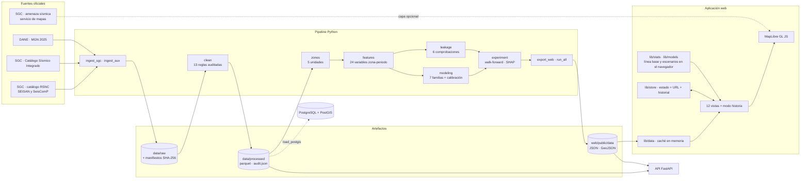
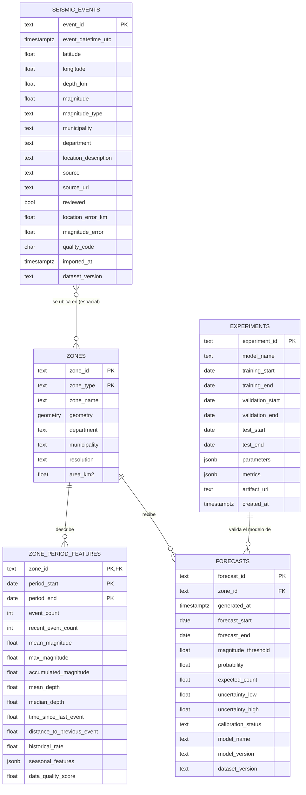

# Arquitectura del sistema

## Visión general

SismoNexo tiene dos mitades que se comunican solo por archivos:

1. **Pipeline (Python)**: descarga datos oficiales, los limpia, entrena y valida modelos y escribe artefactos JSON.
2. **Aplicación (TypeScript)**: sitio estático que lee esos artefactos. No necesita servidor propio.

La API (FastAPI) y la base PostGIS son la **arquitectura objetivo**: exponen los mismos datos para otros clientes, pero el prototipo desplegado no depende de ellas. Esta separación es deliberada: el resultado científico se calcula una sola vez, queda versionado y la interfaz no puede alterarlo.

## Diagrama de componentes



## Flujo de datos

```mermaid
sequenceDiagram
  participant S as SGC / DANE
  participant P as Pipeline
  participant F as Archivos versionados
  participant W as Navegador
  P->>S: Consultas por año o mes, con pausa entre solicitudes
  S-->>P: XLSX / HTML / GeoJSON originales
  P->>F: data/raw + manifiesto (URL, fecha, SHA-256, registros)
  P->>F: events.parquet + audit.json (limpieza)
  loop 45 configuraciones (unidad × horizonte × umbral)
    P->>P: tabla zona-periodo (solo pasado → variables; futuro → etiqueta)
    P->>P: 8 bloques walk-forward: ajustar → calibrar → probar
    P->>P: detector de fugas, SHAP, pronóstico vigente
    P->>F: web/public/data/fc/<id>.json
  end
  P->>F: index.json (procedencia, versiones), quality.json, events.json
  W->>F: index.json al iniciar; el resto bajo demanda
  W->>W: filtros, agregaciones y línea base recalculada en memoria
  W->>W: estado → URL compartible (sin almacenamiento persistente)
```

## Modelo entidad-relación



La relación entre eventos y zonas es espacial (un evento pertenece a una zona de cada unidad) y no se materializa como clave foránea. El esquema SQL está en `db/migrations/001_init.sql`.

## Stack y decisiones

| Decisión | Motivo |
|---|---|
| React + Vite + TypeScript estricto | Sitio estático que se despliega en cualquier hospedaje; carga diferida por vista. |
| MapLibre GL JS sin deck.gl | Hexágonos, cuadrículas y columnas 3D con capas nativas: menos peso y una sola dependencia de mapa. |
| Estilo de mapa propio (sin teselas externas) | Funciona sin conexión y sin depender de terceros; relieve y mapa de referencia son opcionales. |
| Gráficos SVG propios con d3-scale y d3-shape | Control total de accesibilidad: resumen, tabla alternativa y exportación en cada gráfico. |
| Zustand + URL, sin `localStorage` | El estado compartible vive en la URL; el resto, en memoria. |
| Gradient boosting por histogramas de scikit-learn | Misma familia que LightGBM/XGBoost sin exigir `libomp` en el sistema. |
| Línea base y escenarios en el navegador | Los filtros personalizados responden al instante; la paridad con Python se prueba automáticamente. |
| Asistente por reglas | Nunca inventa resultados: o calcula sobre los datos o dice que no sabe. |

## Rendimiento

- Código dividido por vista; MapLibre (≈ 290 kB comprimido), H3 y la generación de PDF se cargan solo cuando se usan.
- El catálogo viaja en formato columnar (4,6 MB; ≈ 1,2 MB comprimido) y se convierte a arreglos tipados.
- Filtros con búsqueda binaria por tiempo y caché; la máquina del tiempo filtra en la GPU sin reconstruir los datos.
- Archivos con huella en el nombre y caché inmutable; los datos se revalidan siempre.

## Seguridad y privacidad

- Sin cuentas, cookies, analítica ni envío de datos de uso.
- Importación de archivos en el navegador: límite de 15 MB y 200.000 filas, lista de extensiones, detección de binarios, saneamiento de textos y neutralización de fórmulas al exportar CSV.
- API: validación con Pydantic, límite de solicitudes por cliente, tamaño máximo de carga, identificador de solicitud y registros JSON sin IP ni parámetros.
- Cabeceras `X-Content-Type-Options`, `Referrer-Policy`, `X-Frame-Options` y `Permissions-Policy` en Vercel y en Nginx.
- Secretos solo por variables de entorno (`.env`, nunca versionado).
